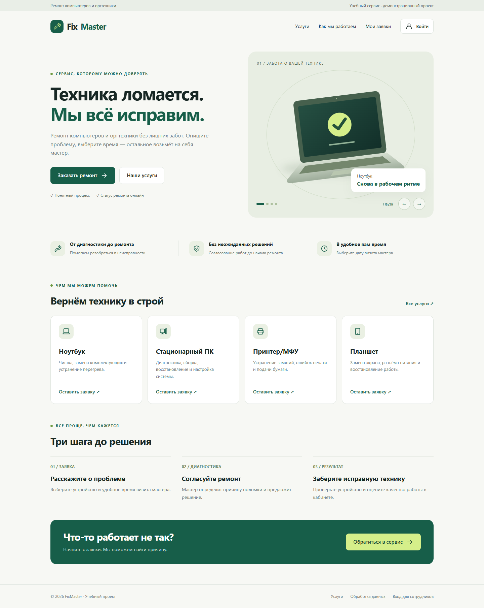

# FixMaster

Учебная онлайн-платформа заказа ремонта компьютеров и оргтехники по заданию «3 уп». Клиент создаёт заявку и следит за ремонтом, администратор назначает мастера и обновляет статус. Данные сохраняются в SQLite между перезапусками.

## Запуск

Нужен Node.js версии 24 или новее. Установка npm-пакетов для работы сервера не требуется.

```sh
npm start
```

Откройте http://localhost:3200. В Windows можно запустить `start-local-site.cmd` двойным щелчком и оставить окно сервера открытым. Если используется встроенный Node.js Codex, скрипт запуска найдёт его автоматически.

## Демонстрационные аккаунты

| Роль | Email | Пароль |
| --- | --- | --- |
| Клиент | client@fixmaster.test | FixClient!2026 |
| Администратор | admin@fixmaster.test | FixAdmin!2026 |

На странице входа есть кнопки заполнения демонстрационных данных. Также можно зарегистрировать нового клиента. Новый клиент начинает с пустого списка заявок. При первом запуске создаются 15 демонстрационных заявок, чтобы проверить статусы и пагинацию. Эти сведения вымышлены.

## Страницы

| Файл | Назначение |
| --- | --- |
| public/index.html | Главная, слайдер, услуги и этапы работы |
| public/services.html | Категории ремонта и подготовка устройства |
| public/register.html | Регистрация с ошибками рядом с полями |
| public/login.html | Вход клиента и администратора |
| public/requests.html | Личный кабинет, статусы и отзывы |
| public/new-request.html | Тип устройства, неисправность, календарь визита |
| public/admin.html | Фильтры, поиск, назначение мастеров и пагинация |
| public/privacy.html | Информация об обработке данных учебного проекта |

Все страницы адаптированы для 390×844 и для настольного экрана. Слайдер содержит четыре оригинальные векторные иллюстрации размером 640×560; переключение происходит каждые 3000 мс. Доступны стрелки, точки и пауза. При системной настройке уменьшения анимации автопереключение изначально приостановлено.

HTML страниц находится в отдельных файлах. Личный кабинет и формы загружают данные через сервер, поэтому их нужно открывать по HTTP, а не двойным щелчком по HTML.

## Функциональность

- Регистрация: имя, уникальный email без учёта регистра, российский номер +7, пароль 8–128 символов, подтверждение пароля и согласие.
- Вход: сообщение о неверном email или пароле на форме. Роли проверяются сервером.
- Заявка: четыре типа устройства, описание 10–2000 символов, будущее время визита в пределах года, защита от дубликата для того же устройства и времени.
- Статусы: Новая → В работе → Ожидает запчасти → Выполнена. Администратор может выбирать статус по фактическому состоянию; для начала работ требуется мастер. «Выполнена» означает, что устройство отремонтировано и выдано клиенту.
- Отзыв: только для своей выполненной заявки, один раз, оценка 1–5 и текст 10–2000 символов. Возврат заявки с опубликованным отзывом в незавершённый статус запрещён.
- Администратор: совместная фильтрация по типу и статусу, поиск по имени/email/описанию, пять заявок на страницу, уведомление о назначении мастера.

## Данные и безопасность

База создаётся в `.local-data/fixmaster.sqlite` и исключена из Git. Пароли хешируются scrypt с индивидуальной солью, токены сессии хранятся в базе как SHA-256. Cookie имеет HttpOnly и SameSite=Lax; сессия действует сутки. Запросы SQL параметризованы, пользовательский текст экранируется перед выводом, включены CSP и ограничение размера JSON. Есть ограничение частоты входа и регистрации.

Это локальный учебный проект. Перед доступом из интернета требуются HTTPS, отдельные рабочие настройки и проверка эксплуатации. Для нового запуска без демонстрационных данных задайте `DEMO_MODE=0`, `ADMIN_PASSWORD` от 12 символов и при необходимости `ADMIN_EMAIL`; используйте новый `DATA_DIR`, иначе существующая база сохраняется. Для HTTPS установите `SECURE_COOKIE=1`. Порт задаётся `PORT`, адрес прослушивания — `HOST`. Время визита выбирается в местном часовом поясе компьютера; клиент и сервер в данной локальной версии должны использовать один часовой пояс.

## Проверка

```sh
npm run check
npm test
```

API-проверка создаёт отдельную временную базу и покрывает 17 сценариев (18 результатов Node Test Runner с родительским тестом). Проверяются права доступа, поля, уникальность email, заявки, отзывы, статусы, двойная фильтрация и пагинация.

Для браузерной проверки установите Playwright в своё окружение и запустите `node scripts/browser-qa.mjs` при работающем сервере. Можно задать `PLAYWRIGHT_PACKAGE` как абсолютный путь к установленному пакету, `BROWSER_PATH` как путь к Edge/Chromium и `BASE_URL` как адрес тестового сервера. Проверка создаёт тестовые заявки в выбранной базе, поэтому используйте отдельный `DATA_DIR`. Скриншоты и результаты сохраняются в `output/playwright/` и не включаются в Git. Сценарии: восемь страниц при двух разрешениях, ошибки формы, создание заявки, окно отзыва, фильтры, страницы списка, назначение мастера, мобильное меню и таймер слайдера.

## Структура

- `server.js`: HTTP API, SQLite, сессии и проверка данных.
- `public/`: восемь HTML-страниц, общие стили и клиентский код.
- `public/assets/`: оригинальные компактные SVG без внешних загрузок.
- `scripts/build.py`: генератор отдельных страниц и иллюстраций; для повторной генерации нужен Python 3 без сторонних пакетов.
- `tests/api.test.js`: проверки полного цикла ремонта.
- `docs/Выполнение задания.md`: соответствие требованиям.

Внешние платные API, отправка сообщений и реальные заказы не используются. Публикация исходников в GitHub не запускает Node.js-сервер; для просмотра нужен локальный запуск.

## Проверенный результат

Проверено 27 октября 2026 года локально в Microsoft Edge: 18 результатов API-проверок и 26 сценариев браузерной проверки прошли. Для каждого из восьми экранов проверены 1440×1000 и 390×844, загрузка изображений и отсутствие горизонтальной прокрутки. Создание заявки, окно отзыва, назначение мастера, фильтры, пагинация, таймер 3000 мс и мобильное меню работают. Ожидаемый ответ 422 при проверке пустой формы обработан интерфейсом; ошибок JavaScript не обнаружено.



[Главная при ширине 390 пикселей](docs/screenshots/mobile-390x844.png)
